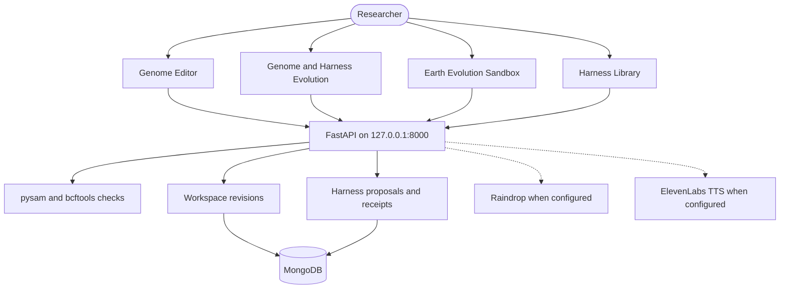

# HELIXA
## The Living Genome Studio

**Explore Life's Code.**

The name HELIXA is the label for this research studio. It is not a trademark registration and not a claim of affiliation. See [docs/branding/NAME_CLEARANCE_REQUIRED.md](docs/branding/NAME_CLEARANCE_REQUIRED.md).

HELIXA is an interactive genome research studio. You describe a biological question, inspect a proposed in-silico edit, and see what is known, predicted, or still uncertain.

Earlier work in this repository was built under the name DIAMOND Genome. That name remains on historical documents, the Python package `diamond-genome`, the database name `diamond_genome`, and anatomy ids prefixed `DIAMOND:`. See [docs/BRANDING_MIGRATION.md](docs/BRANDING_MIGRATION.md).

**Research use only.** HELIXA does not provide medical diagnosis, treatment recommendations, or instructions for real-world biological alteration.

## What it is for

Genomic workflows can report success while the reference build, allele, or metadata is wrong. HELIXA keeps those checks explicit:

- A precise substitution is drafted only when the text names a base and a coordinate the loaded reference can check.
- A trait wish, such as greater ultraviolet tolerance, becomes a research proposal. The candidate edit stays pending until evidence and a valid reference identify one. `POST /api/research/investigations` can attach Europe PMC titles and an Ensembl id when the user names one gene. It abstains from an allele when the prompt does not give `contig:position REF>ALT`. A paper title is not a finding, and expression is not an organ-shape prediction.
- Harness changes are proposed, evaluated against held-out cases, and promoted only when the policy gate allows it.
- Population playback is a stored model of allele frequency, not a history of the Earth.

## The four tabs

| Tab | What you do there |
|---|---|
| **Genome Editor** | Turn the body figure, read the loaded sequence, and type or speak a question. Precise edits open a review. Trait goals open a HELIXA Genome Edit Proposal. Nothing is saved until you confirm a validated edit. |
| **Genome & Harness Evolution** | Read the lineage of genome revisions and harness versions for the active workspace. |
| **Earth Evolution Sandbox** | Play back a population simulation on a declared horizon. The control can be set as far as 2,000,000 years. That horizon is a model parameter, not a reconstruction of Earth. |
| **Harness Library** | List workspaces, compare them, and switch the active genome. A workspace is a genome revision plus its analysis harness. |

## Architecture



| Layer | What this repository uses |
|---|---|
| Web | React 18, TypeScript, Vite, Tailwind, TanStack Query |
| 3D | Three.js, React Three Fiber. Body meshes are original parametric geometry. Unmodeled organs stay labeled unavailable. |
| API | FastAPI, Pydantic v2, Uvicorn |
| Genomics | pysam, bcftools, and the pinned EBI VCF validator binaries when present |
| Data | PyMongo async client. Local MongoDB is the documented default. Atlas is used only when `MONGODB_URI` points at it. |
| State | JSON workspace file for the V10/V14 studio, plus MongoDB for durable runs, events, and receipts |

## Integrations

These adapters exist. A missing key is reported as not configured. This README does not claim a live sponsor round-trip.

| Integration | Status in a fresh checkout |
|---|---|
| **MongoDB** | Local URI in `.env.example` (`mongodb://127.0.0.1:27017`). Atlas is supported by the client when you set `MONGODB_URI` yourself. This publication does not include a live Atlas credential or a claim that Atlas write verification passed. |
| **Raindrop** | `RAINDROP_ENABLED=false` and an empty write key. The adapter sanitizes payloads and stays `NOT_CONFIGURED` until you enable it. |
| **ElevenLabs** | `ELEVENLABS_ENABLED=false` and an empty API key. Text captions remain available. Server speech-to-text is a separate switch and is not implied by the TTS adapter. |
| **Voyage embeddings** | `VOYAGE_ENABLED=false` and an empty key. Retrieval falls back to lexical search. A key alone does not mark the service connected. |

## Setup

Requirements: Linux or macOS, Python 3.12, Node.js 20+, pnpm, and a local MongoDB if you want persistence.

```bash
bash scripts/setup.sh
cp .env.example .env
make mongo-start
make dev
```

The API listens on `127.0.0.1:8000`. The web app listens on `127.0.0.1:5173`. Fill secrets only in `.env`. Files named `.env` are gitignored. Do not put private keys in any `VITE_` variable; Vite inlines those into the browser bundle.

`.env.example` contains placeholders and a local MongoDB URI. It is safe to commit.

## Tests and the synthetic demo

Publication results, including commands and counts, are in [docs/release/HELIXA_TEST_RESULTS.md](docs/release/HELIXA_TEST_RESULTS.md). Local commands:

```bash
.venv/bin/ruff check services
.venv/bin/pytest -q services/tests
pnpm --filter web test
pnpm --filter web lint
pnpm --filter web build
make demo
```

`make demo` runs the synthetic reference-integrity demo. It does not need Atlas, Raindrop, or ElevenLabs.

## Limits

- A sentence about a desired trait is not a variant. HELIXA will not fill in an allele to satisfy it.
- A validated base change updates the virtual sequence. It does not, by itself, change the body mesh or prove a phenotype.
- Expression in a tissue is not evidence that editing a gene would reshape that organ.
- The Earth tab can play a horizon up to two million years. The figures are output of a bounded population-genetic model with a declared generation time. They are not a geological or genealogical history.
- The default teaching contig is a synthetic chromosome 22 slice. It is labeled as such. Short GRCh38 windows, when present, are Ensembl release 116 slices with their own checksums, not a full reference genome.
- No screenshot is shipped in this repository. Local captures under `artifacts/` are generated files and are not part of the publication.

## Provenance, license, and citations

- Code license: [MIT](LICENSE), copyright 2026 DIAMOND Genome Contributors. The product name is HELIXA; the copyright line was not rewritten over earlier files.
- Notices: [THIRD_PARTY_NOTICES.md](THIRD_PARTY_NOTICES.md)
- What was written here and what was reused: [DEVELOPMENT_PROVENANCE.md](DEVELOPMENT_PROVENANCE.md)
- Research notes: [RESEARCH.md](RESEARCH.md)

Cite, when you use the corresponding data:

- Ensembl release 116, assembly GRCh38.p14, for the short reference slices and gene coordinates. Data use follows EMBL-EBI terms. Ensembl software is Apache-2.0.
- Uberon anatomy terms via OLS4. Uberon is CC BY 3.0.
- Human Protein Atlas tissue annotations, where cached, are CC BY-SA 3.0. Those excerpts are not MIT.
- Bgee expression calls are CC0. Cite Bgee.
- GWAS Catalog associations follow EMBL-EBI terms.

Share-alike third-party body meshes are not included. The ban is recorded in the V14 license review.
