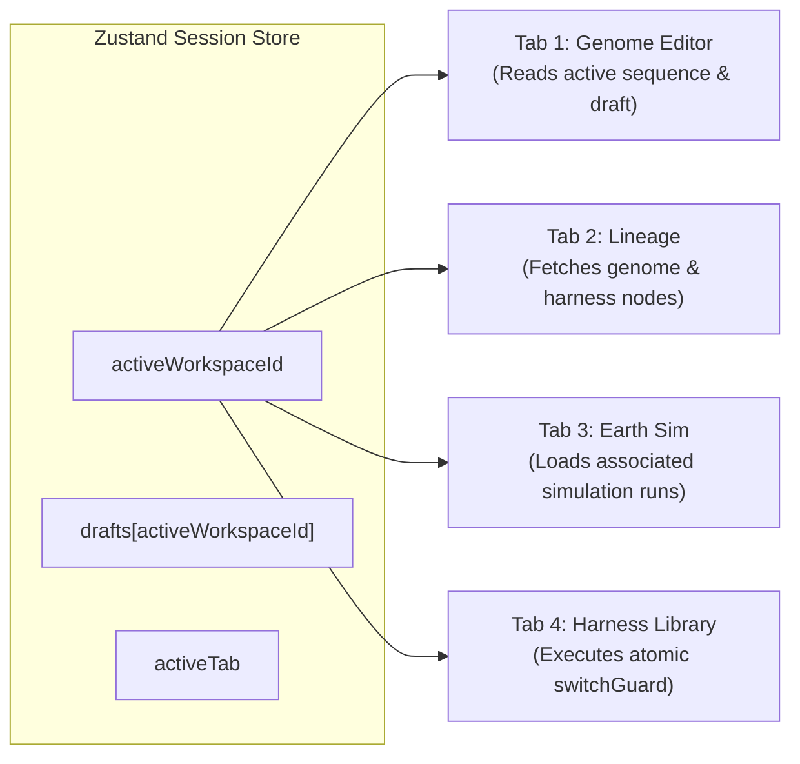

# HELIXA V17 — Five-Agent Interface Contracts & Schema Specifications
**Document ID:** AGENT-CONTRACT-001  
**Timestamp:** 2026-10-11T23:48:00Z  
**Campaign:** HELIXA V17 Product Identity & Autonomous Engineering  

---

## 1. Domain Ownership Matrix

```
+-----------------------------------------------------------------------------------------------+
|                             FIVE-AGENT WORKSTREAM OWNERSHIP                                   |
+--------------------------+--------------------------+-----------------------------------------+
| Agent & Role             | Owned Paths              | Core Responsibilities                   |
+--------------------------+--------------------------+-----------------------------------------+
| **Agent 1**              | `apps/web/src/`          | Visual identity, HELIXA wordmark/motif, |
| Product Identity & UI/3D | `apps/web/public/`       | design tokens, four-tab navigation,     |
|                          | `apps/web/tests/v17/`    | responsive geometry, scene preservation.|
+--------------------------+--------------------------+-----------------------------------------+
| **Agent 2**              | `services/api/app/`      | Backward-compatible API naming, config  |
| Backend & API            | `services/api/routes/`   | aliases, OpenAPI metadata, route aliasing|
| Compatibility            | `services/tests/test_v17`| and health endpoint contracts.          |
+--------------------------+--------------------------+-----------------------------------------+
| **Agent 3**              | `services/runtime/`      | WorkspaceStore multi-tab synchronization|
| MongoDB & State          | `services/integrations/` | immutable genome/harness lineages,      |
| Integrity                | `artifacts/cas/`         | non-destructive persistence rules.      |
+--------------------------+--------------------------+-----------------------------------------+
| **Agent 4**              | `services/integrations/` | Sponsor telemetry brand labels (Raindrop|
| Sponsor & Voice          | `services/api/voice/`    | ElevenLabs, Voyage AI, OpenAI) with zero|
| Integrations             | `services/tests/v16/`    | secret exposure or PII leakage.         |
+--------------------------+--------------------------+-----------------------------------------+
| **Agent 5**              | `scripts/`               | Independent QA verification suite,      |
| QA & Product Credibility | `docs/branding/`         | `make verify-helixa-rebrand`, demo runs,|
|                          | `docs/milestones/`       | rename inventory, release certification.|
+--------------------------+--------------------------+-----------------------------------------+
```

---

## 2. API Schema Contracts

### `GET /api/health`
```json
{
  "status": "HEALTHY",
  "service": "diamond-genome-api",
  "product_display_name": "HELIXA",
  "database": "diamond_genome",
  "atlas_connected": false,
  "integrations": {
    "raindrop": "NOT_CONFIGURED",
    "elevenlabs": "NOT_CONFIGURED",
    "voyage": "NOT_CONFIGURED"
  }
}
```
- **Invariants:**
  - `service` field retains immutable backward-compatible identifier `diamond-genome-api`.
  - `product_display_name` reflects dynamic brand identity `HELIXA`.
  - `database` defaults to `diamond_genome`.

---

## 3. Four-Tab Global State Synchronization Contract

The client uses `@tanstack/react-query` and Zustand session stores (`apps/web/src/v12/state/session.ts`):



### Invariants:
1. **Atomic Switch:** Switching a workspace card in Tab 4 transitions `activeWorkspaceId`, immediately triggering re-renders across all four tabs simultaneously.
2. **Draft Safety:** Unsaved draft mutations in Tab 1 are stored locally per `workspace_id`. Switching workspaces preserves drafts in-memory without discarding or auto-committing.
3. **Lineage Separation:** Tab 2 displays two parallel lanes:
   - Lane A: Genome revision tree (`genome_revision_id`, parent, edits, SHA-256).
   - Lane B: Independent analysis harness iterations (`harness_version_id`, tools, receipts).
