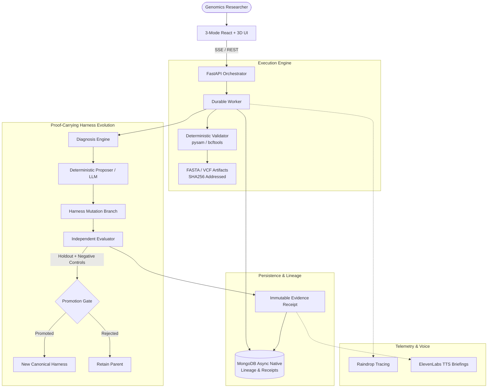

# DIAMOND Genome Architecture

## System Overview

DIAMOND Genome enforces computational integrity in AI-driven genomic workflows through **Proof-Carrying Harness Evolution (PCHE)**.

## Core Subsystems

1. **Deterministic Scientific Validator**:
   - Parses VCF headers and variant records with `pysam.VariantFile`.
   - Compares declared REF allele against sequence at coordinates in `pysam.FastaFile`.
   - Verifies contig availability, lengths, and normalization assumptions.
   - Emits structured findings (`PASS`, `FAIL`, `WARNING`, `INCONCLUSIVE`).

2. **Harness Evolution State Machine**:
   - Explicit versioned `HarnessSpec` separated from immutable `PolicyEnvelope`.
   - Bounded mutation proposals modifying context policies and validation requirements.
   - Isolated replay of parent and candidate harnesses under equivalent conditions.
   - Independent Evaluator with private holdouts and negative controls to prevent over-filtering.

3. **Durable Persistence & Chaos Recovery**:
   - MongoDB native async driver managing tasks, runs, checkpoints, mutations, and evidence receipts.
   - Leases with timeouts for workers.
   - Idempotent tool execution and recovery after process termination (`SIGKILL`).

4. **3D DNA & Evolution Scene**:
   - Right-handed double helix rendered in Three.js / React Three Fiber.
   - Continuous rotation on elapsed-time clock (not frame-dependent).
   - 300-second deterministic procedural morph between visual modes.
   - Real scientific evidence markers linked directly to locus findings.
