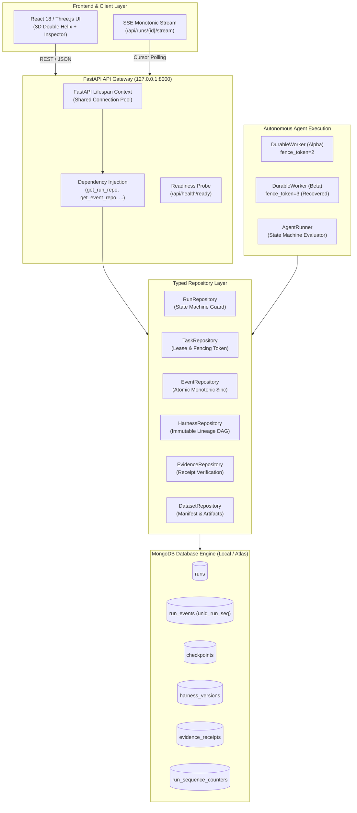

# DIAMOND Genome V5 — Milestone 01: System Architecture
## Distributed Durability, Event Streaming, and Connection Pooling

### 1. Executive Summary

Milestone 01 establishes the production-grade persistence and distributed durability foundation for DIAMOND Genome V5. It transforms the initial proof-of-concept into an enterprise-grade agent harness backed by MongoDB (supporting local MongoDB 7.0 and MongoDB Atlas sandboxes), providing:

1. **Lifespan-Managed Connection Pooling:** Zero per-request connection overhead using native `pymongo.AsyncMongoClient` scoped to FastAPI application lifespan with bounded timeouts (`minPoolSize=5`, `maxPoolSize=50`).
2. **Atomic Monotonic Sequence Allocation:** Guarantees contiguous, strictly increasing sequence integers per execution run via atomic `$inc` counters, eliminating race conditions and `(run_id, seq)` index collisions under high concurrency.
3. **Distributed Worker Fencing Tokens:** Generation tokens (`fence_token: int`) that atomically increment upon lease acquisition, ensuring that zombie or partitioned workers cannot corrupt state upon waking.
4. **Graph-Enforced State Transitions:** Strict transition enforcement that rejects illegal state jumps or modifications to terminal states.
5. **Decoupled Repositories Layer:** Clean repository abstractions across all 12 logical collections, strictly isolating internal BSON `ObjectId` fields from external REST and SSE APIs.
6. **Honest Multi-Mode Diagnostic Probing:** Clear distinction between `NOT_CONFIGURED`, `CONFIGURED`, `REACHABLE`, `AUTHENTICATED`, and `WRITE_VERIFIED` states across `local`, `test`, and `atlas-hackathon` deployment modes.

---

### 2. Architecture Diagram



---

### 3. Key Components and Subsystems

#### 3.1 MongoDB Lifespan Connection Pooling (`MongoDBClient`)
- **Scoped Lifecycle:** Configured in `services/api/app/main.py` via FastAPI `@asynccontextmanager lifespan`. A single connection pool is instantiated on startup, bound to `app.state.mongo`, and cleanly closed upon shutdown.
- **Connection Parameters:**
  - `minPoolSize`: 5 connections
  - `maxPoolSize`: 50 connections
  - `serverSelectionTimeoutMS`: 5000 ms
  - `connectTimeoutMS`: 5000 ms
  - `appname`: `diamond-genome`
- **Deployment Modes:**
  - `atlas-hackathon`: Selected when `MONGODB_URI` contains `mongodb+srv://` or `mongodb.net`.
  - `local`: Selected when connecting to local daemon (e.g. `127.0.0.1:27017`).
  - `test`: Configured under test runner environments.
  - **Atlas Strictness:** If `MONGODB_REQUIRE_ATLAS=true`, connections to non-Atlas URIs fail immediately with `ConfigurationError` to prevent silent localhost fallbacks.

#### 3.2 Monotonic Event Sequencing (`EventRepository`)
To guarantee that the unique compound index `uniq_run_seq` on `(run_id, seq)` is never violated during concurrent execution or worker restarts, sequence allocation is delegated to an atomic MongoDB operation:
```python
counter_doc = await self.db.run_sequence_counters.find_one_and_update(
    {"run_id": run_id},
    {"$inc": {"seq": 1}},
    upsert=True,
    return_document=ReturnDocument.AFTER,
)
seq = counter_doc["seq"]
```
Because MongoDB guarantees document-level atomicity on single document updates, concurrent workers or parallel tool calls receive strictly monotonic, gapless integers (`seq=1, 2, 3...`) with zero contention or duplicate key errors.

#### 3.3 Generation Fencing Tokens (`TaskRepository` & `RunRepository`)
Worker leases prevent duplicate work and split-brain phenomena using monotonic generation fencing:
1. When a worker claims or reclaims a lease, MongoDB atomically increments `fence_token` by 1 using `find_one_and_update`.
2. The claiming worker retains this `fence_token` in memory.
3. Every state transition, checkpoint save, or status update explicitly conditions on `fence_token`:
   ```python
   if fence_token is not None and current_run.fence_token != fence_token:
       raise FencingTokenConflictError(
           f"State transition rejected: fencing token {fence_token} is stale."
       )
   ```
4. If Worker 1 pauses (e.g. network partition or OS freeze) and Worker 2 acquires the lease (bumping `fence_token`), Worker 1's subsequent writes are unconditionally rejected.

#### 3.4 State Machine Transition Enforcement
State progression strictly follows the directed acyclic graph specified in `ALLOWED_RUN_TRANSITIONS`:
```text
CREATED ──► VALIDATING ──► DIAGNOSING ──► MUTATING ──► EVALUATING ──► PROMOTED / REJECTED ──► COMPLETED
   │             │              │             │             │
   ▼             ▼              ▼             ▼             ▼
PAUSED        PAUSED         PAUSED        PAUSED        PAUSED
   │
   ▼
FAILED / CANCELLED (Terminal)
```
Any attempt to skip steps (e.g. `CREATED -> COMPLETED`) or transition away from a terminal state raises an explicit `InvalidStateTransitionError`.

---

### 4. Security and Compliance

- **Research Use Only (RUO):** All outputs and API responses are explicitly marked for research and validation use only; no clinical diagnostic claims are made.
- **Local Loopback Binding:** API server binds strictly to `127.0.0.1`, and CORS middleware restricts origins exclusively to local development servers (`http://127.0.0.1:5173`, `http://localhost:5173`).
- **HTTP Security Headers:** Every API response includes `X-Content-Type-Options: nosniff`, `X-Frame-Options: DENY`, and `Referrer-Policy: strict-origin-when-cross-origin`.
- **Secret Redaction:** `sanitize_mongodb_uri()` automatically masks database credentials in all logs, diagnostics, and test artifacts.
