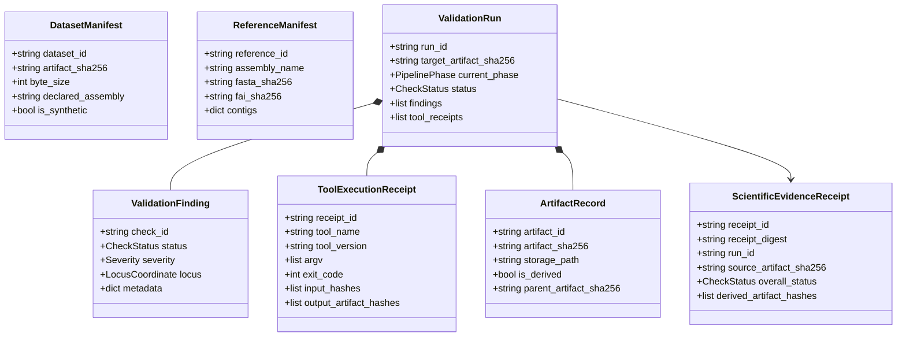

# DIAMOND Genome V5 — Milestone 02: Genomic Data Contracts & Typed Schemas
> **Append-Only Living Architectural Memory**
> This document details the immutable typed schemas implemented in `services/runtime/genomics/contracts.py`.

---

## 1. Schema Hierarchy Overview

---

## 2. Pydantic Models Specification

### 2.1 `ValidationFinding` (Legacy Alias: `Finding`)
- `check_id` (`str`): Unique check rule identifier (e.g. `reference_ref_allele_match`, `contig_length_boundary_check`).
- `status` (`CheckStatus`): One of `PASS`, `FAIL`, `WARNING`, `INCONCLUSIVE`, `ERROR`.
- `severity` (`Severity`): One of `INFO`, `LOW`, `MEDIUM`, `HIGH`, `CRITICAL`.
- `source_artifact_sha256` / `artifact_id` (`str`): Cryptographic SHA-256 of the source VCF.
- `reference_sha256` / `reference_artifact_id` (`str | None`): SHA-256 of the reference FASTA against which the finding was evaluated.
- `locus` (`LocusCoordinate | None`): `chrom`, `pos` (1-based), `ref`, `alt`, and optional `id`.
- `confidence_basis` (`str`): Provenance basis (e.g. `pysam_fasta_fetch`, `vcf_header_parsing`).
- `message` (`str`): Human-readable scientific finding message.
- `metadata` (`dict[str, Any]`): Ground truth and declared values (e.g. `{"declared_ref": "G", "fasta_ref": "T"}`).

### 2.2 `ToolExecutionReceipt` (Legacy Alias: `ToolTrace`)
- `receipt_id` (`str`): Unique execution identifier.
- `tool_name` (`str`): Native tool (e.g. `bcftools`, `pysam`).
- `tool_version` (`str`): Tool version string (e.g. `1.24`, `0.24.1`).
- `argv` / `args` (`list[str]`): Strict argument array executed (no shell interpolation).
- `exit_code` (`int`): Subprocess or call return code.
- `input_hashes` (`list[str]`): SHA-256 digests of all input files.
- `output_artifact_hashes` (`list[str]`): SHA-256 digests of any derived files.
- `stdout_summary` / `stderr_summary` (`str`): Captured standard output and error snippets.
- `runtime_ms` (`float`): Execution duration in milliseconds.

### 2.3 `ValidationRun` (Legacy Alias: `ValidationReport`)
- `run_id` (`str`): Stable run identifier.
- `dataset_id` (`str`): Dataset identifier.
- `target_artifact_sha256` (`str`): SHA-256 of the input dataset artifact.
- `current_phase` (`PipelinePhase`): Active pipeline phase (`INGESTED`, `PARSED`, `REFERENCE_RESOLVED`, `STRUCTURE_CHECKED`, `REF_CHECKED`, `NORMALIZATION_CHECKED`, `EVIDENCE_COMMITTED`).
- `status` / `overall_status` (`CheckStatus`): Aggregate run validation status.
- `findings` (`list[ValidationFinding]`): Collected check findings.
- `tool_receipts` / `tool_traces` (`list[ToolExecutionReceipt]`): Audited tool execution receipts.
- `derived_artifact_records` (`list[ArtifactRecord]`): Derived normalized artifacts.
- `evidence_receipt_id` (`str | None`): Pointer to committed `ScientificEvidenceReceipt`.

### 2.4 `ScientificEvidenceReceipt`
- `receipt_id` (`str`): Immutable receipt UUID.
- `receipt_digest` (`str`): SHA-256 hash over canonical JSON payload of run evidence.
- `run_id` (`str`): Target run ID.
- `source_artifact_sha256` (`str`): Hash of input VCF.
- `declared_reference` (`str | None`): Header-declared assembly (e.g. `GRCh38`).
- `selected_fasta_sha256` (`str | None`): Hash of indexed reference FASTA.
- `tool_chain` (`dict[str, str]`): Versions of tools used during validation.
- `findings_summary` (`dict[str, int]`): Count of findings by check status.
- `overall_status` (`CheckStatus`): Final verdict.
- `derived_artifact_hashes` (`list[str]`): List of derived artifact SHA-256 digests.
