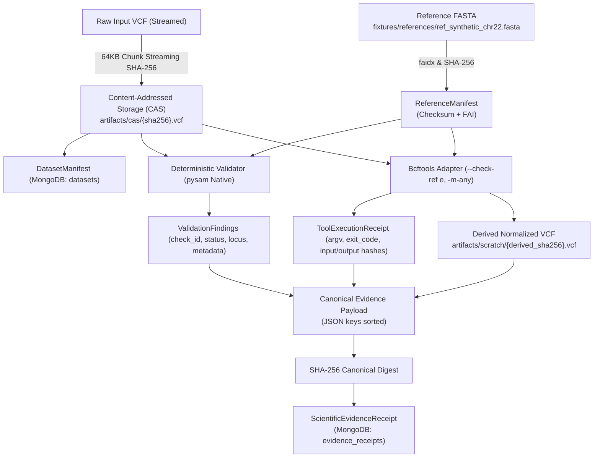

# DIAMOND Genome V5 — Milestone 02: Evidence Provenance & Cryptographic Lineage
> **Append-Only Living Architectural Memory**
> This document details the cryptographic verification and content-addressed storage lineage for genomic validation.

---

## 1. Cryptographic Lineage Architecture

Scientific reproducibility requires that every finding, transformation, and verdict can be mathematically reconstructed back to raw source inputs. DIAMOND Genome achieves this through a multi-tier cryptographic evidence graph:



---

## 2. Invariant Verification: Source Byte Preservation

In genomic analysis, silent modification of input data (such as `--check-ref s`) is catastrophic to research integrity. DIAMOND Genome enforces two layers of byte-identity guarantees:

1. **In-Process Validator Invariant:**
   ```python
   pre_sha = compute_sha256(vcf_file)
   # ... read-only variant parsing ...
   post_sha = compute_sha256(vcf_file)
   assert pre_sha == post_sha, "Invariant violation: Original VCF was mutated!"
   ```
2. **Subprocess Adapter Normalization Invariant:**
   - Normalization executes `bcftools norm -m-any --fasta-ref <ref> -o <derived_output> <source_input>`.
   - The original file `source_input` is verified to have an identical SHA-256 hash before and after execution.
   - The derived file is stored under its own unique SHA-256 hash in CAS / scratch space and linked via `parent_artifact_sha256`.

---

## 3. Canonical Evidence Receipt Formulation

The `ScientificEvidenceReceipt` is computed deterministically from the canonical JSON representation of the run's verified artifacts:

```json
{
  "receipt_id": "ev-rcpt-03f56de89cec",
  "run_id": "run-val-1a835eaf4d3a",
  "source_artifact_sha256": "2384ddc028d07fb13c2ccaa4fef0c30693ff50b58be129b3cfdf31e42ca85e82",
  "declared_reference": "GRCh38",
  "selected_fasta_sha256": "43b526cba16cc6307b19f7e61aba26caee6ebec5b3a400ec23382d79f268fae6",
  "tool_chain": {
    "bcftools": "1.24",
    "pysam": "0.24.1",
    "validator": "DeterministicGenomicsValidator-v5"
  },
  "findings_summary": {
    "PASS": 2
  },
  "overall_status": "PASS",
  "derived_artifact_hashes": []
}
```

The SHA-256 digest over this canonical JSON string yields the tamper-proof `receipt_digest`. Any modification to the toolchain versions, findings summary, or source/reference hashes invalidates the digest.
